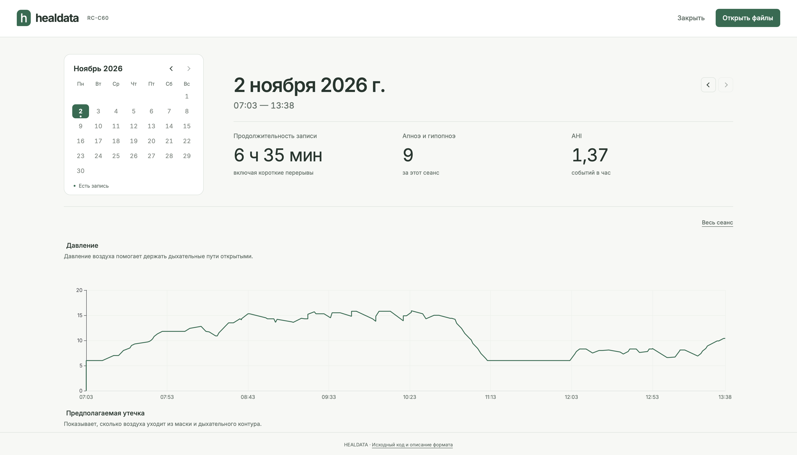

# HEALDATA для Micromed RC-C60

`healdata` — библиотека на Go для чтения дневных файлов HEALDATA с аппарата Micromed RC-C60. Декодер разработан по выгрузкам с моего RC-C60. Он извлекает измерения давления, дополнительные каналы и события, рассчитывает сводку и объединяет записи в сеансы сна, в том числе через полночь. Поддерживаемый вариант формата и известные ограничения описаны в [карте полей](docs/format.md).

## Библиотека Go

Для подключения к своему проекту потребуется Go 1.26 или новее.

```sh
go get github.com/IvanSaratov/micommed-reader/pkg/healdata
```

Передайте в `DecodeDay` содержимое одного дневного файла. Дату возьмите из его имени. Например, для файла `20010203`:

```go
import "github.com/IvanSaratov/micommed-reader/pkg/healdata"

func readDay(raw []byte) (*healdata.Day, error) {
	return healdata.DecodeDay(raw, healdata.Source{
		ReportDate: healdata.Date{Year: 2001, Month: 2, Day: 3},
	})
}
```

В `day.Pressure` и `day.Events` доступны измерения и события. Метод `day.Stats()` возвращает суточную сводку. Для нескольких файлов одного источника `GroupSessions(days, 60)` собирает сеансы с перерывами до 60 минут включительно. [Пример чтения файла](pkg/healdata/contract_test.go)

## CLI

Утилита `healdata` использует ту же библиотеку. Она принимает файл, папку или ZIP, показывает сводку и экспортирует данные в JSON и CSV.

```sh
go install github.com/IvanSaratov/micommed-reader/cmd/healdata@latest
healdata inspect ./HealData/
healdata summary ./HealData.zip
healdata export json -o report.json ./HealData.zip
healdata export csv -o report-csv ./HealData.zip
```

## Веб-интерфейс

Откройте дневные файлы или ZIP и выберите дату в календаре. Для выбранного сеанса доступны сводка, графики и лента событий. Go-библиотека работает прямо в браузере через WebAssembly, поэтому записи обрабатываются на вашем устройстве.



Для запуска из корня репозитория нужны Go и Node.js 22.12 или новее.

```sh
cd web
npm ci
npm run dev
```

[Подробнее о веб-интерфейсе](web/README.md) · [Лицензия MIT](LICENSE)
